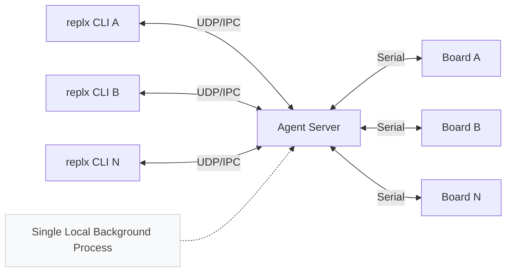
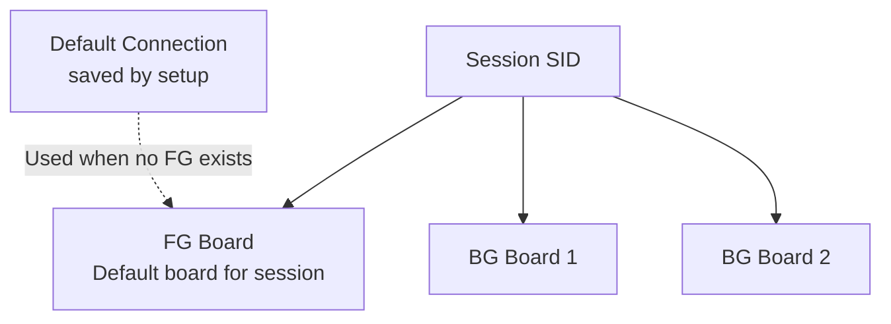
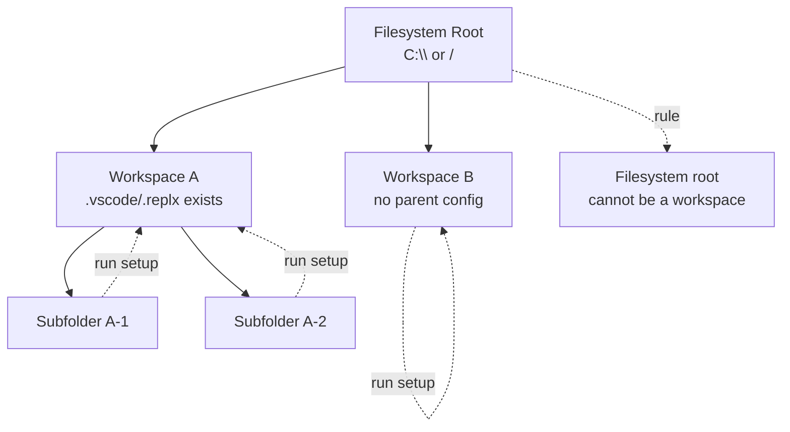
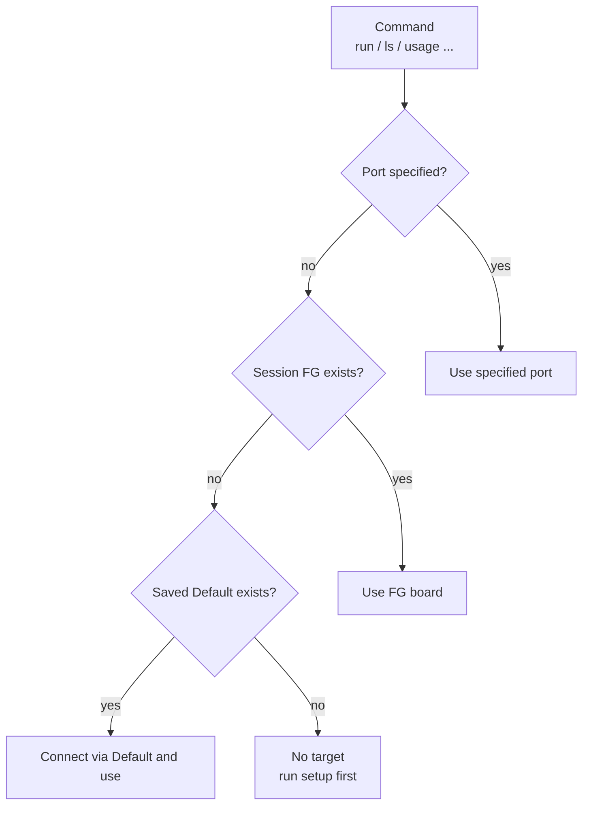

# replx

[](https://badge.fury.io/py/replx)
[](https://www.python.org/downloads/)
[](https://opensource.org/licenses/MIT)

`replx` is a CLI tool for MicroPython development that uses a single local agent-based architecture to connect and manage multiple CLI sessions and multiple boards, improving connection efficiency and enabling parallel workflows.

**Host support:** Windows, macOS, and Linux (Python 3.10+).  
**Device support:** Standard MicroPython 1.29.0 or newer, plus a separate legacy compatibility path for Digi XBee3 Zigbee. The bundled modern `mpy-cross` compiler is **not** compatible with all older Digi runtimes; XBee deployments use `.py` source.

---

## Board compatibility and verification

| Board | Firmware/runtime | Verification status |
|---|---|---|
| Raspberry Pi Pico 2 W (RP2350) | MicroPython 1.29+ | Actual board testing completed by the maintainer |
| Waveshare ESP32-P4-WIFI6 (P4 + C6) | MicroPython 1.29+ (firmware must match the chip revision) | rev v3.2 / `v1.30.0-preview.147.g9e348d293c` C6_WIFI: connection, file hash round-trips, Wi-Fi status/scan/off, BLE on/off/scan/advertise (after C6 upgrade + patched build), and peripheral smoke tests verified; 921600-baud REPL build verified (see below). See the wireless limits below; native USB and external-device signal tests are not verified |
| Digi XBee3 Zigbee (EFR32MG) | Digi firmware 1014 or later, with its vendor MicroPython runtime | Legacy compatibility code and emulated-API regression tests; the legacy transfer path (paced 256-byte raw REPL, no raw-paste, `stat`-free listing/download) was also exercised over a real serial link on an RP2350 board. Physical XBee3 validation still required |

Physical validation checklist for a new board (run in order; each step should succeed before the next):

```sh
replx PORT -c "import sys; print(sys.implementation)"   # connection and runtime identity
replx PORT put big_file.bin /t.bin                      # use a file larger than 16 KiB
replx PORT get /t.bin back.bin                          # compare hashes of big_file.bin and back.bin
replx PORT put some_dir /some_dir                       # nested directory upload
replx PORT get /some_dir some_dir_back                  # nested directory download
replx PORT ls -r /some_dir
replx PORT rm -r -f /t.bin /some_dir
replx PORT gpio write PIN 1                             # then each supported Hardware command from the table below
```

Digi firmware numbers (such as `1014`) are **not** MicroPython version numbers. XBee3 is not required to run MicroPython 1.29, nor is the vendor runtime assumed to implement modern MicroPython APIs. Use `replx -c "import sys; print(sys.implementation); print(sys.version)"` to inspect the runtime.

### Waveshare ESP32-P4-WIFI6 setup

- Use firmware built for the board's actual P4 chip revision and wiring. Official P4 downloads distinguish early chips (`PRE_REV3`) from revision 3+ and provide separate C6 Wi-Fi/BLE variants. Check the chip revision with `esptool chip-id`; on the tested rev v3.2 board, the v1.29.0 release images that were checked declared a maximum chip revision of v1.99 and would not boot, so a revision 3 `v1.30.0-preview` C6_WIFI build was used.
- The board's Type-C port is a CH343 USB-UART bridge. MicroPython fixes the REPL baud at build time (default 115200, about 10 KiB/s on the wire); `machine.UART(0, baudrate=...)` cannot change it at runtime (`ESP_ERR_INVALID_STATE`). For faster transfers, flash the 921600-baud REPL build described in [921600-baud REPL over CH343](#921600-baud-repl-over-ch343). replx detects either rate automatically.
- A standalone P4 build does not expose Wi-Fi/BLE merely because the board contains a C6. The MicroPython build, SDIO wiring configuration, and C6 coprocessor firmware must all match the board. `wifi` requires `network.WLAN`; `ble` requires `bluetooth.BLE`. Missing APIs now produce an explicit firmware-support error.
- Use GPIO numbers, not physical header positions: `GPIO4`, `GP4`, and `4` all mean MCU GPIO 4. Select accessible, unreserved pins from the Waveshare schematic. Do not copy Pico pin examples without checking the P4 pinout.
- ADC scope requires explicit ADC-capable pins on P4. The implicit GP26/GP27/GP28 channels apply only to RP2 boards. ADC voltage displays are an estimate based on `--vref`, not an ESP32 ADC calibration; check attenuation and the ADC's input range.
- `i2s` drives a raw I2S peripheral. It does not configure the board's onboard audio codec/amplifier, MCLK, or power controls. Use an appropriately wired external I2S device or initialize the codec separately in a script.

#### P4 wireless verification and limits

The P4 has no radio of its own: Wi-Fi and BLE depend on the **separate C6 ESP-Hosted firmware**, the P4 `C6_WIFI` variant, and matching transport wiring. Installing ordinary standalone MicroPython on the C6 does not provide this coprocessor service.

- Wi-Fi status, scan and off work on the tested board. The CLI recognizes ESP32 status codes (`1000`, `1001`, `1010`, `201`, `202`, etc.) separately from RP2/CYW43 codes. Connection failure detection uses the firmware's `network.STAT_*` constants. Successful association/DHCP and boot reconnect still require testing with your own SSID/password. SSIDs are case-sensitive.
- **BLE requires two fixes; official P4 C6_WIFI images (tested: `v1.30.0-preview.147`) crash on `bluetooth.BLE().active(True)`** with a `Store access fault`/Guru Meditation panic. The causes were identified as follows:
  1. **Old C6 coprocessor firmware.** The board ships with factory ESP-Hosted firmware that reports version `0.0.0` (`Version mismatch: Host [2.7.0] > Co-proc [0.0.0]` in the IDF log). It must be upgraded to ESP-Hosted **2.7.0** to match current MicroPython builds. The C6 has no USB port of its own, so the upgrade is done *through the P4* with an OTA helper.
  2. **MicroPython P4 C6_WIFI build bug.** NimBLE is built with `CONFIG_BT_NIMBLE_STATIC_TO_DYNAMIC=y`, and MicroPython resets NimBLE globals before `nimble_port_init()` allocates them (NULL store → the panic above). In addition, the ESP32 port never connects/enables the **remote** BT controller on the C6, so even without the panic, activation fails with `ETIMEDOUT` (`HCI wait for ack returned 19`). A patched build is required until this is fixed upstream.
- **Verified with both fixes** (C6 ESP-Hosted 2.7.0 + patched `v1.30.0-preview.147` build) on rev v3.2:
  - `ble on`, `ble off` and re-activation; status shows MAC/address type/GAP name/MTU.
  - `ble scan` live listing (hundreds of reports per second).
  - `ble advertise` start/stop.
  - BLE active together with a Wi-Fi scan.
  
  GATT connections and L2CAP are not verified with a second device.
- The C6 upgrade image, P4 OTA helper, patched MicroPython image and source patch are kept in the repository's `res/esp32p4-wifi6-c6-hosted-2.7.0/` folder. Procedure:
  ```sh
  replx COM3 get / backup           # back up board files first
  replx shutdown                    # release the port
  # 1) Flash the OTA helper (it updates the C6 from its LittleFS partition at boot)
  cd res/esp32p4-wifi6-c6-hosted-2.7.0/p4_ota_helper
  python -m esptool --chip esp32p4 -p COM3 -b 460800 write-flash --flash-mode dio --flash-freq 80m --flash-size 16MB 0x2000 bootloader.bin 0x8000 partition-table.bin 0xd000 ota_data_initial.bin 0x10000 host_performs_slave_ota.bin 0x410000 storage.bin
  # 2) Watch COM3 at 115200 until the OTA finishes, then press RESET once
  # 3) Restore MicroPython (erase removes the helper's partitions)
  python -m esptool --chip esp32p4 -p COM3 erase-flash
  replx COM3 firmware update --file ../micropython/ESP32_GENERIC_P4-C6_WIFI-v1.30.0-preview.147-ble-uart-921600.bin
  ```
  After the reset, the `Version mismatch` warning should be gone. An `activate` RPC error from the factory C6 firmware during OTA is expected: it does not implement that RPC, but the new image still boots after reset. The C6 upgrade is persistent; later P4 firmware updates do not undo it.
- `ble` status does not enable a disabled radio merely to read its MAC. Use `ble on` explicitly. MAC/GAP/MTU information is queried only while active, and fields the firmware cannot report (such as the write-only `addr_mode`) are omitted. If activation crashes the firmware, replx reports the native crash instead of waiting indefinitely or replaying activation. Power-cycle if necessary.
- GATT helpers require `aioble` on the board (`replx COM3 mip install aioble`); install it only after basic radio activation works. `ble stream` additionally requires BLE L2CAP channel APIs. Firmware without them is rejected with a specific error; ordinary GATT support does not imply L2CAP support.

#### P4 header pins and hardware checks

Use the [Waveshare pinout](https://www.waveshare.com/w/upload/e/e2/ESP32-P4-WIFI6-details-inter.jpg) and [schematic](https://files.waveshare.com/wiki/ESP32-P4-WIFI6/ESP32-P4-WIFI6-datasheet.pdf), not Pico pin assignments. Do not drive flash/PSRAM, C6 transport/reset, USB or other in-use onboard pins.

With no external wiring, the tested firmware executed GPIO write on GPIO2, PWM generation on GPIO2, ADC read on GPIO20, I2C controller scan on SDA=7/SCL=8 (address `0x18` found), I2C Target open/memory read/write/close on 7/8, UART1 open/write on TX=20/RX=21, SPI1 open/transfer on SCK=2/MOSI=3/MISO=4, I2S0 tone/capture on SCK=2/WS=3/SD=4, and a one-pixel WS2812 frame on GPIO5 using `neopixel`. These are **API/command smoke tests**, not waveform, loopback, external I2C transaction, sound or LED-light verification. Release a peripheral before reusing its pins.

- P4 ADC-capable pins are GPIO16..23 and GPIO49..54. This board's exposed ADC header pins are GPIO20..23 and GPIO49..52. GPIO4 and RP2 scope defaults GPIO26..28 are **not** P4 ADC inputs. `--vref` scales `read_u16()` for an estimate; it is not ADC calibration or attenuation configuration. Respect the ESP32 ADC input range, not just the 3.3 V GPIO supply.
- I2C Target uses `machine.I2CTarget`, checked at runtime, and is no longer restricted to RP2350. P4 uses controller/target bus 0 by default.
- P4 uses the GPIO matrix for UART1/SPI1/I2C0. Do not open UART0 while using its REPL. UART writes flush the transmitter before deinitializing it.
- `gpio monitor`, `adc scope`, `pwm monitor` and `i2s scope` were started on P4 and exited with Ctrl+C. This verifies initialization/rendering/cleanup, not external input accuracy or every interactive control. GPIO monitor uses **soft IRQ** on ESP32, which does not accept `Pin.irq(hard=True)`; callback latency and missed edges limit timing accuracy. RP2 keeps its hard IRQ. PWM monitor uses `time_pulse_us`, not RP2 PIO.
- SPI `--slave` remains RP2350-only: its driver uses RP2 PIO/DMA and cannot run on P4; `machine.SPI` exposes controller mode, not a compatible slave API. WS2812 on P4 uses `neopixel`/`machine.bitstream`, never RP2 PIO. Onboard audio codec setup is separate from raw I2S commands.

Examples (connect suitable external devices before testing their signals):

```sh
replx COM3 gpio write GPIO2 1
replx COM3 adc read GPIO20
replx COM3 i2c scan --sda GPIO7 --scl GPIO8
replx COM3 i2c open --sda GPIO7 --scl GPIO8 --target --addr 0x42
replx COM3 i2c write 00 01 02 03
replx COM3 i2c read 00 3
replx COM3 i2c close
replx COM3 uart open --tx GPIO20 --rx GPIO21 --baud 115200
replx COM3 spi open --sck GPIO2 --mosi GPIO3 --miso GPIO4 --baud 1000000
replx COM3 i2s tone --sck GPIO2 --ws GPIO3 --sd GPIO4 440 m100
replx COM3 ws2812 write GPIO5 '[0,0]' 0x000000 --width 1 --height 1
```

#### 921600-baud REPL over CH343

Raising the CH343 REPL rate to 921600 speeds up transfers 2.5–3.5× without extra wiring. It requires a custom firmware build, because raising `MICROPY_HW_UART_REPL_BAUD` alone does not help on stock ESP32 firmware:

- **TX:** when the 128-byte UART FIFO is full, stdout sleeps a whole RTOS tick (10 ms at `CONFIG_FREERTOS_HZ=100`), capping board output near 12.8 KB/s at any baud. `get` and printed output barely improve.
- **RX:** the UART RX interrupt does not wake the waiting interpreter, and the stdin ring buffer is only 260 bytes. At 921600, raw-REPL commands that are not flow-controlled lose bytes (observed as `could not execute command (response: b'')` and truncated uploads).

`res/esp32p4-wifi6-c6-hosted-2.7.0/micropython/micropython-esp32-uart-repl-fast.patch` fixes all three issues: a short busy-wait instead of a tick sleep, an RX wake-up, and a 1024-byte buffer. The folder also contains a ready-made rev3 `C6_WIFI` image with the BLE patch, `*-ble-uart-921600.bin`. Build instructions are in that folder's README; the key step is `make ... CFLAGS_EXTRA=-DMICROPY_HW_UART_REPL_BAUD=921600`.

```sh
replx shutdown
replx COM3 firmware update --file res/esp32p4-wifi6-c6-hosted-2.7.0/micropython/ESP32_GENERIC_P4-C6_WIFI-v1.30.0-preview.147-ble-uart-921600.bin
replx COM3 setup       # detects 921600 automatically
```

Measured on the rev v3.2 board through COM3:

| Test | 115200 (stock-like) | 921600 (patched) |
|---|---|---|
| `-c "print(1)"` ×5 | 2.24 s | 2.20 s |
| `put` 64 KiB random | 10.56 s | 3.90 s |
| `put` 181 KB `.py` (deflate) | 10.73 s | 5.96 s |
| `get` 64 KiB | 9.26 s | 3.00 s |
| print 2000 lines (~90 KB) | 8.34 s | 2.58 s |

Notes:
- The ROM bootloader still prints at 115200, and esptool's flashing baud (`firmware update --baud`) is independent of the REPL baud.
- A serial terminal other than replx must be set to 921600 after flashing this build.
- Rates above 921600 are untested. If you build one, put it first in `REPLX_BAUD` (see [Serial baud rate](#serial-baud-rate)).

#### Native USB CDC REPL on P4-WIFI6

**Try the existing firmware first; reflashing is not necessarily required.** Upstream `ESP32_GENERIC_P4` enables native USB CDC by default on chips with USB OTG. P4 defaults to the **high-speed OTG PHY (RHPORT1)**, while the full-speed PHY can separately provide USB Serial/JTAG. The tested preview exposes `machine.USBDevice.BUILTIN_CDC`, so its CDC driver is compiled in. Actual USB enumeration and speed could not be tested without the native USB cable.

1. **Identify the connectors.** The board's Type-C port is the CH343 USB-UART bridge, not native USB. The separate **4-pin USB connector marked V, D-, D+, G** is the USB 2.0 high-speed OTG port. Use the correct board-compatible USB data cable/adapter and verify its pin order from the schematic. The header's GPIO24/25 (`DM`/`DP`) is a different, full-speed interface; do not confuse it with the HS OTG connector. Do not improvise power wiring, short D+/D-, or parallel unrelated host 5 V supplies.
2. Keep the UART recovery connection available. Connect the OTG port to the PC in **USB device mode**, not through a host-only OTG setup. Use a known data cable. Reset the board normally (do not hold BOOT). No UART baud-rate change is needed for USB CDC.
3. Enumerate ports on the PC:

   ```powershell
   python -m serial.tools.list_ports -v
   replx scan
   ```

   Look for a **new** USB CDC port, separate from CH343. Windows usually assigns another COM number; Linux uses a `ttyACM` device and macOS a `cu.usbmodem` device. Match the USB descriptors/serial number, not a guessed COM number or the bootloader device.
4. Explicitly select the new port (replace COM7 below with the actual port):

   ```powershell
   replx shutdown
   replx COM7 -c "import os; print(os.uname())"
   replx COM7 usage
   replx COM7 put .\large.bin /usb-test.bin
   replx COM7 get /usb-test.bin .\usb-test-back.bin
   Get-FileHash .\large.bin
   Get-FileHash .\usb-test-back.bin
   replx COM7 rm /usb-test.bin
   ```

   Matching hashes validate the transfer. Time the same payload over CH343 and native CDC separately; neither USB 480 Mbit/s signalling nor a CDC baud setting guarantees equivalent file throughput. Flash writes, interpreter work and USB buffering still matter. Do not run two replx sessions against the same board via UART and USB simultaneously.
5. If no CDC port appears, check cable/power/device role and the board's `boot.py` USB configuration before rebuilding. On the UART REPL, inspect `hasattr(machine.USBDevice, 'BUILTIN_CDC')` after importing `machine`. **`machine.USBDevice().active()` is the runtime-device state, not proof that built-in CDC is disabled**; the runtime object can report inactive/`BUILTIN_NONE` while built-in USB is active. Do not call `active(False)` or select `BUILTIN_NONE` as a diagnostic over your only USB connection.

If your firmware genuinely omits CDC, build a matching variant. This example is for **rev 3.x + C6**, using Linux/WSL2 for compilation and Windows for flashing. A different revision needs `PRE_REV3_C6_WIFI`. Choose an exact MicroPython commit/tag and the ESP-IDF version recommended by that checkout; the inspected source recommends IDF v5.5.5. The example pins the tested preview for reproducibility. For working BLE, also apply `res/esp32p4-wifi6-c6-hosted-2.7.0/micropython/micropython-p4-c6-ble.patch` after `git checkout` (`git apply <path>`), and upgrade the C6 as described in *P4 wireless verification and limits*.

```bash
# Linux / WSL2 (not PowerShell)
sudo apt-get update
sudo apt-get install -y git make gcc build-essential cmake ninja-build ccache \
    libffi-dev libssl-dev dfu-util libusb-1.0-0 python3 python3-venv python3-pip
git clone --branch v5.5.5 --recursive https://github.com/espressif/esp-idf.git
cd esp-idf
./install.sh esp32p4
. ./export.sh
cd ..
git clone https://github.com/micropython/micropython.git
cd micropython
git checkout 9e348d293c
make -C mpy-cross
cd ports/esp32
make BOARD=ESP32_GENERIC_P4 BOARD_VARIANT=C6_WIFI submodules
make BOARD=ESP32_GENERIC_P4 BOARD_VARIANT=C6_WIFI
```

Inspect `ports/esp32/mpconfigport.h` and your board/variant overrides: `MICROPY_HW_ENABLE_USBDEV=1`, `MICROPY_HW_USB_CDC=1` and `MICROPY_HW_USB_HS=1` must remain enabled for this HS connector. `ESP32_GENERIC_P4/mpconfigboard.h` keeps UART REPL enabled as well, providing recovery via CH343. The standard variant already inherits these USB defaults; do not add unrelated ESP-IDF console settings or disable UART. A custom board variant must also match the Waveshare C6 SDIO/reset wiring and ESP-Hosted firmware. This procedure (with the BLE patch) was compiled in WSL2 Ubuntu 24.04 with IDF v5.5.5 and flashed to the rev v3.2 board through CH343; native USB enumeration itself remains untested.

Copy `ports/esp32/build-ESP32_GENERIC_P4-C6_WIFI/firmware.bin` from WSL to Windows as, for example, `D:\firmware\P4-C6-USB.bin`. This is the **merged image**, not `micropython.bin` (the app-only image). Back up the board filesystem, then use the UART recovery port:

```powershell
replx COM3 get / .\p4-backup
replx COM3 firmware update --file D:\firmware\P4-C6-USB.bin
```

The flash offset for merged P4 firmware is **0x2000**, not the original ESP32's 0x1000. Do not use `--erase` unless you intend to erase user data. If the REPL is unavailable, use `replx firmware update --flash-port COM3 --file D:\firmware\P4-C6-USB.bin`; hold BOOT, tap RESET and release BOOT if automatic bootloader entry fails. C6 firmware is **not** updated by this command; use the P4-hosted OTA helper in `res/esp32p4-wifi6-c6-hosted-2.7.0/` instead. After a successful P4 write, reset and repeat the native USB enumeration and hash checks above.

Sources: [MicroPython P4 board/variants](https://github.com/micropython/micropython/tree/master/ports/esp32/boards/ESP32_GENERIC_P4), [USB port defaults](https://github.com/micropython/micropython/blob/master/ports/esp32/mpconfigport.h), [USBDevice semantics](https://docs.micropython.org/en/latest/library/machine.USBDevice.html), [ESP32 build guide](https://github.com/micropython/micropython/blob/master/ports/esp32/README.md), and the Waveshare pinout/schematic above.

### Digi XBee3 Zigbee setup and legacy limits

- Use XCTU to select MicroPython mode (`AP=4`) and configure the REPL UART to 115200 baud to match replx's serial scanner/connection settings. A normal Zigbee transparent/API-mode serial connection is not a Python REPL. replx does not automatically change the module's AT configuration.
- Detection selects the EFR32MG legacy profile automatically; no firmware upgrade to MicroPython 1.29 is requested. Existing EFR32MG-based `xnode` devices retain the same profile.
- Virtual device `/` maps to `/flash`. Upload/download and directory listing use bounded reads; transfers use 256-byte chunks, small upload batches, and a paced classic raw REPL. Raw-paste negotiation is disabled on this profile.
- Use small `.py` programs with `put`, `exec`, `run`, and `repl`. Old runtime syntax, supported modules, heap size, and filesystem capacity still constrain user programs. New Python/MicroPython language features are not backported by replx.
- `mpy` and compilation-based `install` workflows cannot use the bundled modern compiler for XBee. Upload `.py` with `put` instead. `mip install` automatically switches to source mode with a notice; this does **not** guarantee that an arbitrary current package supports Digi's older runtime. User-supplied `.mpy` files must have a separately verified vendor-compatible ABI.
- Hardware pins use Digi names (`D0`..`D9`, `P0`..`P2`), not RP2/ESP32 integers. GPIO supports level read/write and write/delay sequences with an optional level read. Pulse/wait actions and the graphical monitor are excluded on XBee.
- ADC uses `machine.ADC('D0').read()` on D0..D3 and displays native counts, without assuming `read_u16()`, 3.3 V scaling, or ESP32 attenuation. `--vref` conversion and `adc scope` are not supported on XBee.
- I2C controller mode uses **bus 1**, **SDA=P1 (DIO11)**, **SCL=D1 (DIO1)**. These are defaults for XBee `scan`/`open`; alternative pins and target mode are not supported. No pin-selection keywords or `I2C.deinit()` are sent.
- SPI, secondary UART, `machine.PWM`, I2S, WS2812, Wi-Fi, and general-purpose MicroPython BLE commands are outside replx's XBee3 Zigbee support. A radio/AT feature does not imply that the corresponding standard `machine`/`network`/`bluetooth` API exists. These CLI commands reject XBee explicitly; use Digi APIs in your own scripts for vendor-specific radio operations.

```sh
replx COM7 -c "print('XBee legacy REPL')"
replx COM7 put main.py /
replx COM7 run -d /main.py
replx COM7 gpio write D0 1
replx COM7 gpio read D0 read
replx COM7 gpio seq D0 1 m10 0 D1 read
replx COM7 adc read D0 D1 --repeat 5 --interval 1000
replx COM7 i2c scan
replx COM7 i2c open --sda P1 --scl D1
replx COM7 i2c read 0x42 2
```

Only use the hardware examples after checking pin ownership, wiring, and electrical limits; a command can reconfigure a pin currently used by another peripheral.

References: [Waveshare board documentation](https://www.waveshare.com/wiki/ESP32-P4-WIFI6), [MicroPython P4 firmware variants](https://micropython.org/download/ESP32_GENERIC_P4/), Digi [Pin](https://docs.digi.com/resources/documentation/digidocs/90002219/reference/r_class_pin.htm), [ADC](https://docs.digi.com/resources/documentation/digidocs/90002219/reference/r_class_adc.htm), and [I2C](https://docs.digi.com/resources/documentation/digidocs/90002219/reference/r_class_i2c.htm) APIs.

---

## Core Architecture



Each CLI command communicates with a background Agent Server over UDP/IPC. The Agent Server handles all serial communication with the boards. This design allows multiple terminal sessions to share connection state while consistently handling FG/BG switching, status queries, and command execution.

### Agent Process and Port

- `replx` uses one local Agent Server per PC.
- The agent listens on a UDP port selected from `49152-65535`.
- The selected port is stored in `~/.replx/.config` as `AGENT_PORT=...` and reused by later CLI commands.
- If the stored port is occupied by another program and no replx agent is running there, replx selects a new free port and updates `~/.replx/.config`.

### Session / FG / BG / Default

- **Session (SID)**: A unique work context created per terminal
- **FG (Foreground) connection**: The board used as the default target in the current session
- **BG (Background) connection**: Additional boards attached to the same session alongside FG
- **Default connection**: Board info saved by `setup`, reused when no port is specified



Key rules:

1. A session can have **one FG + multiple BG** boards.
2. The FG board can be used without specifying a port in most commands.
3. To target a BG board, the port must be specified explicitly.
4. After `setup`, the saved default connection makes port-omitted execution straightforward.

### setup and Workspace Scope

`setup` is not just a connect command — it initializes the development environment relative to the **current VS Code workspace**.



1. Running `setup` configures MicroPython type hints, VS Code settings, and the default port (Default connection) for that workspace.
2. The filesystem root (`C:\`, `/`) cannot be used as a workspace.
3. A workspace can contain subfolders — running `setup` from a subfolder applies settings to the parent workspace scope.
4. If no workspace config exists in a parent path, each subdirectory is treated as an independent workspace with its own default port.

### Which board does a command target?

General commands (`run`, `ls`, `usage`, etc.) resolve the target board using the following flow:



1. If a port is specified in the command, that port takes priority.
2. Otherwise, the session's FG board is used.
3. If no FG exists, a connection is attempted using the saved Default.

The recommended approach: **use `setup` to make a board the default**, and only specify a port when needed.

Both of the following forms work identically:

- `replx --port PORT setup`
- `replx PORT setup` (shorthand)

`PORT` depends on the OS:
- Windows: `COM4`
- Linux: `/dev/ttyACM0`, `/dev/ttyUSB0`, or `/dev/serial/by-id/...`
- macOS: `/dev/cu.usbmodem14101` or `/dev/cu.usbserial-0001`

### Two command groups

#### Commands that work without a port
These commands are primarily for querying or managing state, not direct board interaction. They operate independently or based on session context. Using `-p/--port` with these commands is an error.

- `replx scan` — discover connectable boards (no connection made)
- `replx status` — check session/FG/BG connection state
- `replx whoami` — show the FG board for the current session
- `replx shutdown` — shut down the agent and all connections
- `replx theme` — show or customize UI colors and panel style
- `replx --help`, `replx COMMAND --help` — help
- `replx -v` — version

#### Commands that require a board connection
These commands communicate with the board. Except for `setup`, the port can be omitted if an FG or Default connection exists.

- Connection/session: `setup`, `fg`, `disconnect`
- Execution/interaction: `exec`, `run`, `repl`, `shell`
- Files: `ls`, `cat`, `get`, `put`, `cp`, `mv`, `rm`, `mkdir`, `touch`
- Board: `usage`, `reset`, `format`, `init`, `wifi`, `firmware`
- Package/compile: `mip`, `pkg`, `mpy`
- Hardware: `gpio`, `pwm`, `adc`, `uart`, `spi`, `i2c`, `i2s`, `ws2812`, `ble`

---

### Usage Scenarios

#### Scenario #1 — Start a new project
1. Run `replx scan` to identify the port
2. Run `replx PORT setup` to initialize the workspace and save the default connection
3. Run `replx ls` to confirm basic operation

#### Scenario #2 — Multiple terminals / multiple boards
1. Connect the required boards from terminals A and B
2. Run `replx status` to check FG/BG state per SID
3. Use `replx fg` or `replx PORT fg` to switch as needed

#### Scenario #3 — Quick code experimentation
- One-liner: `replx -c "print('hello')"`
- Run a file: `replx run app.py`
- Start REPL: `replx repl`

#### Scenario #4 — File and library management
- File sync: `put/get/ls/cat/...`
- Interactive file shell: `replx shell`
- Library update: `replx pkg search` → `replx pkg download` → `replx pkg update core.all`

#### Scenario #5 — End of session / cleanup
- Release port only: `replx disconnect`
- Full shutdown: `replx shutdown`

---

## Command Reference

### Command Summary

#### Connection / Session

| Command | Description |
|---|---|
| `setup` | Register the board as the default target and initialize the development environment. |
| `scan` | Discover available ports and board information. |
| `status` | Show FG/BG connection state per session. |
| `fg` | Switch the FG board for the current session. |
| `whoami` | Show the FG board the current session is targeting. |
| `disconnect` | Release the board connection for the current session. |
| `shutdown` | Shut down the agent and clean up all session connections. |
| `theme` | Show or customize panel colors and box style. |

#### Execution / Interaction

| Command | Description |
|---|---|
| `exec` (`-c`) | Execute a short Python snippet immediately. |
| `run` | Run a local Python file on the board. |
| `repl` | Start an interactive REPL session. |
| `shell` | Open an interactive shell for board filesystem operations. |

#### File Operations

| Command | Description |
|---|---|
| `ls` | List files and directories at a board path. |
| `cat` | Print the contents of a board file. |
| `get` | Download a file or directory from the board to local. |
| `put` | Upload a local file or directory to the board. |
| `cp` | Copy files or directories within the board. |
| `mv` | Move or rename files or directories within the board. |
| `rm` | Delete files or directories on the board. |
| `mkdir` | Create a directory on the board. |
| `touch` | Create a file if missing; preserve existing contents. |

#### Board Management

| Command | Description |
|---|---|
| `usage` | Show storage and RAM usage with free space. |
| `reset` | Soft-reset the board. |
| `format` | Format the board filesystem. |
| `init` | Run initial setup scripts on the board. |
| `wifi` | Manage Wi-Fi configuration and connection state. |
| `firmware` | Check, download, or update board firmware. |

#### Package / Compile

| Command | Description |
|---|---|
| `mip` | Search and install MicroPython packages from the official index or GitHub. |
| `pkg` | Search, download, and update MicroPython packages. |
| `mpy` | Compile `.py` files to `.mpy` bytecode. |

#### Hardware

| Command | Description |
|---|---|
| `gpio` | Read, write, and run GPIO sequences. |
| `pwm` | Generate and monitor PWM signals. |
| `adc` | Read ADC pins and run a board-side scope UI. |
| `uart` | Open, write, read, and monitor UART. |
| `spi` | Open, write, read, and transfer SPI data. |
| `i2c` | Scan, read, write, and dump I2C devices. |
| `i2s` | Play I2S tones and capture/monitor an I2S microphone. |
| `ws2812` | Write pixels and regions on WS2812 LED matrices. |
| `ble` | Manage BLE radio, scan, advertise, GATT server/client, and L2CAP. |

---

### Connection / Session

#### `setup`
The first command to run when starting a new project. After confirming the board connection, it creates `.vscode/tasks.json`, `.vscode/settings.json`, and `.vscode/launch.json`, configures the Pylance typehint path, and saves the current port as the workspace Default. A port is required, except for `--clean`.
Settings apply at the workspace level; running from a subfolder applies them to the parent workspace scope. If no config exists in a parent path, each path is treated as an independent workspace with its own default port.
The filesystem root (`C:\`, `/`) cannot be used as a workspace.

Usage:
```sh
replx PORT setup [--theme THEME]
replx setup --clean
```

Options:
- `--theme THEME`: UI theme preset (`dark`, `white`, `one-dark-pro`, `atom-one-light`, `github-dark`, `github-light`). If omitted, replx tries to detect the VS Code theme and falls back to `dark`. Fine-tune colors later with `replx theme`.
- `--clean`: delete the `.vscode` folder of the current project (configuration and typehints). Does not take a PORT.

Examples:
```sh
replx COM3 setup
replx /dev/ttyACM0 setup
replx /dev/serial/by-id/usb-MicroPython_board setup
replx /dev/cu.usbmodem14101 setup
replx COM3 setup --theme github-light
replx setup --clean
```

#### `scan`
Use this to identify which port belongs to which board before connecting. Combines already-connected agent ports with freshly scanned ports and displays Port / Version / Core / Device / Manufacturer along with connected and Default status.

Usage:
```sh
replx scan
```

Examples:
```sh
replx scan
replx COM3 setup                  # setup using port found by scan
replx /dev/ttyACM0 setup          # Linux example
replx /dev/serial/by-id/usb-MicroPython_board setup # stable Linux port example
replx /dev/cu.usbmodem14101 setup # macOS example
```

Notes:
- `scan` only detects boards; it does not establish a connection.
- `scan` does not require a running agent. When an agent already holds a serial port, it reuses the agent's board metadata and skips reopening that port.
- Using `-p/--port` with `scan` is an error.
- For USB-UART bridges (CH34x, CP210x, FTDI, PL2303) and unknown adapters, `scan` tries each REPL baud candidate. Native USB CDC ports ignore the baud rate and are probed once.

<a id="serial-baud-rate"></a>
**Serial baud rate:** When connecting, replx probes the REPL at 115200, then at 921600, and keeps the first rate that answers. If the board was just reset and is still booting, the probe repeats up to three times. Native USB CDC boards (Pico, ESP32-S3/C6 USB) ignore the rate. To try other rates first, set `REPLX_BAUD`. It accepts a comma- or semicolon-separated list; the defaults are still tried afterwards.

```sh
REPLX_BAUD=1500000 replx COM3 setup        # bash
$env:REPLX_BAUD="1500000"; replx COM3 setup # PowerShell
```

#### `status`
Use this in a multi-terminal environment to inspect FG/BG connections per session at a glance. Shows the current session, foreground/background ports for each session, and the default port.

Usage:
```sh
replx status
```

Examples:
```sh
replx status
replx fg                        # switch foreground after checking status
```

#### `fg`
Switch the foreground board for the current session. `replx fg` presents an interactive list to choose from; `replx PORT fg` immediately promotes the specified port to FG. Subsequent commands (`ls`, `run`, `cat`, etc.) will target the new FG board.

Usage:
```sh
replx fg
replx PORT fg
```

Examples:
```sh
replx fg
replx COM19 fg
replx /dev/ttyACM0 fg
replx /dev/cu.usbmodem14101 fg
```

#### `whoami`
Instantly shows what FG board the current terminal session is targeting.

Usage:
```sh
replx whoami
```

Examples:
```sh
replx whoami
replx COM3 fg && replx whoami   # confirm target after switching FG
```

#### `disconnect`
Disconnects a specific port while keeping the agent process running. `replx disconnect` targets the current session's FG; `replx PORT disconnect` releases the specified port. When a connection is released, it is removed from all sessions that were referencing it.
If the FG is removed, one of the BG boards becomes FG. If no ports remain, the agent shuts down.

Usage:
```sh
replx disconnect
replx PORT disconnect
```

Examples:
```sh
replx disconnect
replx COM3 disconnect
replx /dev/ttyACM0 disconnect
replx /dev/cu.usbmodem14101 disconnect
```

#### `shutdown`
Use this when you are done working and want to clean up sessions, connections, and the agent in one step. The result varies by state: `Shutdown Complete` on success, `Already Shutdown` if already stopped, `Shutdown Failed` on error. The agent will restart automatically the next time a command requires it.

Usage:
```sh
replx shutdown
```

Examples:
```sh
replx shutdown
replx shutdown && replx status  # confirm state after shutdown
```

#### `theme`
Show or customize the terminal UI: panel border colors per category and the global panel box style. Settings are saved in `~/.replx/.config` and apply to every session; no board connection is needed. Category overrides take priority over the base colors of the active theme (for example `vscode-auto` or `one-dark-pro`).

Usage:
```sh
replx theme                         # show the current theme and all panel colors
replx theme color CATEGORY [HEX]    # show or override one category color (#RRGGBB)
replx theme box [STYLE]             # show or set the panel box style
replx theme reset [CATEGORY]        # remove one override, or all overrides
```

- `CATEGORY`: `help`, `success`, `data`, `mode`, `warning`, `neutral`, `error`
- `STYLE`: `rounded` (default), `horizontals`, `square`, `heavy`, `double`, `minimal`

Examples:
```sh
replx theme color help #61afef
replx theme color error #ff4444
replx theme box double
replx theme reset
```

---

### Execution / Interaction

#### `exec` (`-c` alias)
Run a short MicroPython snippet without a file. Sends the `exec` command to the board once and returns standard output immediately. Multiple statements can be chained with semicolons (`;`).

Usage:
```sh
replx exec "CODE"
replx -c "CODE"
```

Examples:
```sh
replx -c "print('hello')"
replx -c "import os; print(os.listdir())"
replx exec "import machine; print(machine.freq())"
replx -c "import time; time.sleep(1); print('done')"
```

#### `run`
The primary command for running scripts. Default mode transfers a local file to the board and runs it interactively. `-d/--device` runs a file already stored on the board interactively. `-n/--non-interactive` detaches execution without waiting for I/O. `-e/--echo` echoes input to the terminal during interactive runs. `--line text|hex` switches to line input mode: output scrolls in a split region while the input line stays fixed at the bottom. `--non-interactive` and `--echo` cannot be used together, and `--line` cannot be combined with either.

Usage:
```sh
replx run SCRIPT
replx run -d SCRIPT
replx SCRIPT
replx run --line text SCRIPT
replx run --line hex SCRIPT
```

Examples:
```sh
replx run main.py
replx main.py              # shorthand for .py files
replx run -d /test.py      # run board's /test.py interactively
replx run -n server.py     # non-interactive (no I/O wait)
replx run -dn /main.py     # run board's /main.py non-interactively
replx run --line text main.py   # line mode: type text, Enter to send
replx run --line hex main.py    # line mode: type hex bytes (e.g. 0102ff), Enter to send
replx main.py --line hex        # shortcut form also works
```

Line mode key bindings:
- `Enter`: send the typed line to the board
- `Backspace`: delete last character
- `Ctrl+U`: clear the input line
- `Ctrl+C` twice: interrupt and exit

#### `repl`
Enter the board's Friendly REPL to experiment with code line by line. Output is displayed in real time. Type `exit()` to end the REPL session.

Usage:
```sh
replx repl
```

Examples:
```sh
replx repl
# Inside REPL:
>>> import os
>>> os.listdir()
>>> exit()
```

Key bindings:
- `Ctrl+C`: interrupt running code
- `Ctrl+D`: soft reset

#### `shell`
An interactive shell for continuous board filesystem management. Supports `ls/cat/cp/mv/rm/mkdir/touch` and `cd/pwd` relative to the current path. This is not a Python REPL. Inside the shell, `run` always operates on board files (`-d` mode), and `-n/-e` options are unavailable.

Usage:
```sh
replx shell
```

Available commands inside the shell:
```sh
# Files
ls cat cp mv rm mkdir touch

# Navigation
cd pwd clear

# Execution
exec run repl

# Other
usage wifi help exit
```

Examples:
```sh
replx shell
:/ > ls
:/ > cd lib
:/lib > cat boot.py
:/lib > exit
```

---

### File Operations

#### `ls`
List the contents of a board directory. Default shows a single-path listing; `-r/--recursive` outputs the full tree. Folder/file type icons and size information are shown, making it useful for pre/post-deploy comparisons.

Usage:
```sh
replx ls [PATH]
replx ls -r [PATH]
```

Examples:
```sh
replx ls
replx ls /lib
replx ls -r
replx ls -r /lib
```

#### `cat`
View the contents of a board file. Text files are shown as-is; binary files are displayed as a hex dump. `-n/--number` adds line numbers for text. `-L/--lines` selects a line range (`N:M`) for text or a byte range (`N:M`, `N:+M`) for binary.

Usage:
```sh
replx cat FILE
replx cat -n FILE
replx cat -L N:M FILE
```

Examples:
```sh
replx cat main.py
replx cat -n /lib/audio.py
replx cat -L 1:30 boot.py
replx cat -L 100:+64 app.mpy
```

#### `get`
Download files or directories from the board to local. Remote patterns (`*`, `?`) are resolved on the board side; directories are downloaded recursively. When downloading multiple sources, the last argument `LOCAL` must be a directory.

Usage:
```sh
replx get REMOTE LOCAL
replx get REMOTE... LOCAL
```

Examples:
```sh
replx get main.py ./
replx get / ./backup            # full board filesystem backup
replx get /a.py /b.py ./
replx get /lib/*.mpy ./compiled
```

#### `put`
Upload local files or directories to the board. Local wildcards (`*`, `?`) are expanded before upload; directories are transferred recursively. The last argument is always the remote destination path; remote directories are created automatically if needed.

Large non-interactive uploads on standard boards use MicroPython raw-paste flow control when a batch is at least 4 KiB. Digi XBee3 always uses its paced classic raw-REPL path. Interactive and detached execution also keeps the standard raw-REPL behavior.

On standard runtimes, each 4 KiB block is sent in the shortest of three forms: a Python bytes literal, Base64, or raw-deflate-compressed Base64 (the last only when the firmware provides the built-in `deflate` module, which is checked once per file and decompressed on the board). Compressed blocks are typically 20–40% smaller for `.mpy` files. Measured with the 47 `.mpy` files (387 KB) installed by `init`: Pico 2 W 11.6 s → 10.2 s, ESP32-P4 (115200-baud UART) 63.7 s → 39.1 s. XBee3 retains its legacy bytes-literal path. Actual throughput depends on the board, filesystem, USB/UART connection, and firmware.

Usage:
```sh
replx put LOCAL REMOTE
replx put LOCAL... REMOTE
```

Examples:
```sh
replx put main.py /
replx put ./lib/audio.py /lib
replx put a.py b.py /lib
replx put *.py /lib
```

#### `cp`
Copy files or directories within the board. Supports single files, directories, multiple sources, and patterns. `-r/--recursive` is required for directories; the destination must be a directory when copying multiple sources.

Usage:
```sh
replx cp SRC DEST
replx cp -r DIR DEST
```

Examples:
```sh
replx cp /main.py /backup.py
replx cp x.py y.py /backup
replx cp /lib/*.mpy /backup
replx cp -r /lib /lib_backup
```

#### `mv`
Move or rename files and directories within the board. Supports single moves, multiple sources, and patterns. `-r/--recursive` is required for directories. When moving multiple sources, verify the destination is a directory first.

Usage:
```sh
replx mv SRC DEST
replx mv -r DIR DEST
```

Examples:
```sh
replx mv /old.py /new.py
replx mv /main.py /backup
replx mv *.py /backup
replx mv -r /lib/audio /lib/sound
```

#### `rm`
Delete files or directories on the board. By default, a confirmation prompt is shown before deletion; `-f/--force` skips the prompt. `-r/--recursive` is required for directories. Pattern deletion (`*.py`, `/lib/*.mpy`) is supported.

Usage:
```sh
replx rm FILE
replx rm -r DIR
replx rm -f FILE
```

Examples:
```sh
replx rm /main.py
replx rm -f /main.py
replx rm /a.py /b.py
replx rm /lib/*.mpy
replx rm -rf /tmp
```

Note: Without `-f`, `rm` cancels when stdin is not interactive (scripts, pipes, CI) and reports `Remove Cancelled`. Use `-f` in automation.

#### `mkdir`
Pre-create a directory structure on the board. Multiple paths can be created at once, including nested paths. Existing directories are silently retained.

Usage:
```sh
replx mkdir DIR
replx mkdir DIR...
```

Examples:
```sh
replx mkdir /lib
replx mkdir /tests
replx mkdir /lib/audio /lib/net
replx mkdir /a/b/c
```

#### `touch`
Create an empty file when it is missing, or ensure that it exists. Existing file contents are preserved; this command does not set modification timestamps.

Usage:
```sh
replx touch FILE
replx touch FILE...
```

Examples:
```sh
replx touch /config.py
replx touch /a.py /b.py /c.py
replx touch /lib/__init__.py
```

---

### Board Management

#### `usage`
Check RAM (`mem`) and filesystem (`df`) usage simultaneously. Shows a usage bar alongside Used/Free/Total values, making it ideal for capacity checks before uploading.

Usage:
```sh
replx usage
replx PORT usage
```

Examples:
```sh
replx usage
replx COM3 usage
replx /dev/ttyACM0 usage
replx /dev/cu.usbmodem14101 usage
```

#### `reset`
Reset the board's execution state. Default is `--soft` (restart the interpreter); `--hard` performs a hardware reset followed by automatic reconnection. Using `--soft` and `--hard` together is an error.

Usage:
```sh
replx reset
replx reset --soft
replx reset --hard
```

Examples:
```sh
replx reset
replx reset --soft
replx reset --hard
```

Options:
- `--soft`: restart the Python interpreter (default)
- `--hard`: hardware reset + auto-reconnect

#### `format`
Completely wipe the board filesystem and start fresh. All user files including `boot.py`, `main.py`, and `lib/` are deleted. Some boards may not support the format command — check the error message if it fails.

Usage:
```sh
replx format
```

Examples:
```sh
replx get /*.py ./backup
replx get /lib ./backup
replx format
```

#### `init`
Restore a board to its initial state and reinstall required libraries. Internally runs `format` followed by sequential core/device package installation. The local package store must be prepared first — run `replx pkg download` before using this for the first time.

Usage:
```sh
replx init
```

Examples:
```sh
replx pkg download
replx init
```

Operation order:
1. Format filesystem
2. Install core libraries
3. Install device libraries

On Pico 2 W and standard ESP32-P4/C6 runtimes, `init` and `pkg update core.*` / `device.*` install libraries in groups of up to 16 files sharing one raw REPL session, avoiding a separate REPL entry for every file. Directory creation and upload failures are reported; an incomplete installation is not reported as successful. XBee3 retains sequential per-file installation.

The transfer optimizations are built into the host tool and MicroPython's REPL; they do not require a transfer helper installed by `init`. Do not rerun `init` just to enable faster uploads: **it erases the filesystem**. After updating replx, restart an older running agent with `replx shutdown` before measuring performance.

#### `wifi`
Manage the board's Wi-Fi status, connection, and boot auto-connect. `wifi connect SSID PW` saves credentials to the board (`wifi_config.py`) and connects immediately. `wifi connect` reconnects using saved settings. `wifi boot on|off` controls whether `boot.py` auto-connects on startup.

Usage:
```sh
replx wifi
replx wifi connect SSID PW
replx wifi connect
replx wifi scan
replx wifi off
replx wifi boot on|off
```

Examples:
```sh
replx wifi
replx wifi scan
replx wifi connect MySSID MyPassword
replx wifi connect
replx wifi boot on
replx wifi off
```

#### `firmware`
Download or install board firmware using the appropriate backend:

- **ticle-lite / ticle-sensor (RP2350):** the existing UF2 path downloads the latest device release, enters bootloader mode, copies to its UF2 drive and reconnects. `-f/--force` reinstalls the same version.
- **ESP32-P4:** uses the dependency **`esptool>=5.6.0,<6`** via the current Python interpreter (`python -m esptool`), without a shell or PATH-dependent executable. esptool provides chip/revision/security checks, bootloader/stub support, compressed writes, high baud rates and verification. Maintaining a second ROM/stub/flashing protocol in replx would duplicate that work without improving serial/flash throughput.
- Normal `pip install` resolves this dependency. For a source checkout, `build.cmd` without arguments intentionally installs with `--no-deps`: use `build.cmd first` after dependency changes, or install `"esptool>=5.6.0,<6"` explicitly in the same Python environment.
- P4 requires an explicit **merged `.bin`** (`--file`) or an HTTPS `ESP32_GENERIC_P4-*.bin` URL (`--url`). Select the correct chip revision and C6_WIFI variant from the [official download page](https://micropython.org/download/ESP32_GENERIC_P4/). Preview builds are not silently selected or automatically installed. A custom merged image can be supplied with `--file`.
- `image-info` runs before releasing the port. `download` never writes to a board and can run without one connected. `update` asks for confirmation, releases only the target agent connection and uses esptool `write-flash 0x2000`. `--yes` confirms the write for automation. esptool's checks are not bypassed; the UF2 `--force` flag is **not** passed to esptool.
- `--baud` controls **flashing only**, not the MicroPython REPL. Default 460800; retry at 115200 for unreliable bridges. `--erase` passes `write-flash --erase-all`, erasing the filesystem/NVS as well. Even without it, back up files before updating: partition layout and filesystem compatibility may change.
- `--flash-port PORT` selects the **P4** bootloader port explicitly and bypasses REPL detection, useful for recovering a board that does not run MicroPython. It does not select or flash the separate C6. Successful esptool write/verification does not certify Wi-Fi, BLE or external peripherals, and the firmware may enumerate a different USB port afterward.

Usage:
```sh
replx firmware download
replx firmware update
replx firmware update -f
```

Options:
- `-f, --force`: force reinstall even if version is unchanged

Examples:
```sh
replx firmware download
replx firmware update
replx firmware update --force
```

P4 examples (PowerShell; choose the exact URL/image for your board):

```powershell
replx firmware download --url "https://micropython.org/resources/firmware/ESP32_GENERIC_P4-C6_WIFI-20261016-v1.30.0-preview.147.g9e348d293c.bin"
# Official P4 C6_WIFI images crash on BLE activation; for BLE use the patched image in
# res/esp32p4-wifi6-c6-hosted-2.7.0/micropython after upgrading the C6 (see P4 wireless section);
# *-ble-uart-921600.bin also enables the faster 921600-baud REPL.
replx COM3 firmware update --file "D:\firmware\selected-P4-C6-merged.bin"
replx firmware update --flash-port COM3 --file "D:\firmware\selected-P4-C6-merged.bin" --baud 115200 --yes
# Add --erase only if a full flash erase is intended.
```

---

### Package / Compile

#### `mip`
Install MicroPython packages from the official micropython.org index or directly from GitHub. All downloading and compilation happen on the PC — the board does not need a Wi-Fi connection. On standard runtimes, `.py` source files are compiled to `.mpy` using `mpy-cross` before upload. The target architecture is auto-detected from the connected board via `sys.implementation._mpy`. On Digi XBee3, installation automatically uses source mode and skips modern `.mpy` compilation; package compatibility with the vendor runtime is still the user's responsibility.

For packages in the official index, pre-compiled `.mpy` files are fetched directly from the CDN when available (`hashes` field). For `github:org/repo` specs without a `package.json`, replx automatically queries the board's architecture and fetches pre-built `.mpy` binaries from the repository's GitHub Pages CDN (e.g. `emlearn-micropython`).

Usage:
```sh
replx mip SUBCOMMAND [args]
```

Subcommands:

| Subcommand | Description |
|---|---|
| `search [QUERY]` | List all packages or filter by name/description |
| `search github:org/repo` | Browse a GitHub repo's package structure |
| `install TARGET[@version]` | Download, compile (if needed), and install to board |

Install Targets:
```sh
requests                  # latest version from official index
requests@0.10.0           # specific version
github:org/repo           # GitHub repo root (package.json or CDN fallback)
github:org/repo/path      # GitHub repo sub-path
github:org/repo/path/foo.py  # single GitHub source file
https://example.com/f.mpy # direct URL
```

Install Options:
- `--device PATH`: board destination path (default: `lib` → `/lib/`)
- `--no-compile`: upload `.py` files directly without `.mpy` compilation
- `--index URL`: use a custom package index instead of the default
- `-s, --source URL`: base URL; the remaining arguments are file names appended to it

Examples:
```sh
replx mip search
replx mip search mqtt
replx mip search github:micropython/micropython-lib
replx mip install requests
replx mip install requests@0.10.0
replx mip install aioble
replx mip install github:emlearn/emlearn-micropython
replx mip install github:org/repo/src
replx mip install --device /lib/ext umqtt.simple
replx mip install --no-compile logging
replx mip install --source https://host/path/ a.mpy b.mpy
```

Notes:
- All network I/O happens on the PC — board WiFi is **not** required.
- On standard runtimes, `.py` files are compiled to `.mpy` before upload (requires `mpy-cross`); XBee3 automatically uses source mode.
- Dependencies declared in `deps` are installed automatically.
- For packages without `package.json` (e.g. native C modules), replx reads the board's `sys.implementation._mpy` to determine architecture (`armv6m`, `armv7emsp`, `xtensawin`, etc.) and fetches matching pre-built `.mpy` files from GitHub Pages.

---

#### `pkg`
Manages the package workflow (`search → download → update`) between the GitHub remote registry, local store, and board. `search [QUERY]` shows results scoped to the connected board's core/device. `download` fetches the remote registry to the local store. `update TARGET` installs packages to the board using `core.all`, `device.all`, `core.<file>`, or `device.<file>`. `clean` removes the current core/device entries from the local store. `--owner/--repo/--ref` specify the GitHub remote and apply to `search/download/update`.

Usage:
```sh
replx pkg SUBCOMMAND [args]
```

Examples:
```sh
replx pkg search
replx pkg search audio
replx pkg search --owner PlanXLab --repo replx_libs --ref main
replx pkg download
replx pkg download --owner PlanXLab --repo replx_libs --ref main
replx pkg update core.all
replx pkg update device.all
replx pkg update core.slip.py
replx pkg update device.termio.py
replx pkg clean
```

> Note: `pkg search/download/update` operates within the **core/device scope of the currently connected board**.

#### `mpy`
Compile `.py` files to `.mpy` bytecode. Automatically selects the target architecture based on the connected board's `core` and version. `-o/--output` can only be used when compiling a single file. `mpy-cross` 1.29 or newer must be installed locally before use; `pip install replx` installs it automatically.

The bundled compiler is not used for Digi XBee3's legacy/vendor `.mpy` ABI. Use `put` for `.py` source or `mip install --no-compile` instead.

Usage:
```sh
replx mpy FILES...
replx mpy main.py -o out.mpy
```

Examples:
```sh
replx mpy main.py
replx mpy main.py -o build/main.mpy
replx mpy *.py
replx mpy src/
```

---

### Hardware

Hardware commands drive on-board peripherals through code generated by replx and executed on the board, so no script is needed. Standard MCU pins accept `GP<num>`, `GPIO<num>`, or a number (case-insensitive); all refer to a GPIO id, not a connector pin number. Digi XBee3 uses named pins as described above. Bus commands (`uart`, `spi`, `i2c`) save their bus settings in agent memory on `open`/`scan` and keep them until `close` or agent restart; the other commands (`gpio`, `pwm`, `adc`, `i2s`, `ws2812`) take their pins on every call. Commands that stream (`--repeat 0`, which is the default for `i2s read`, plus `monitor` and `scope`) run until Ctrl+C.

#### Hardware platform support

This table describes the CLI implementation, not physical verification of every peripheral. P4 API smoke tests are listed above; external-device/interactive signal tests and all XBee functions still require physical validation. "Conditional" requires the corresponding API and dependencies in the installed firmware.

| Feature | Pico 2 W / RP2350 | ESP32-P4-WIFI6 | XBee3 Zigbee |
|---|---|---|---|
| GPIO level read/write, write/delay seq | Write/seq; level read via `seq ... read` | Same, with P4 GPIO ids | Named pins; `gpio read D0 read`, write/seq |
| GPIO pulse/wait, IRQ monitor | Supported; monitor needs `termviz` | `time_pulse_us` and **soft** Pin IRQ; monitor needs `termviz`, with scheduling/edge-rate limits | Excluded |
| PWM write/seq/stop | Supported | `machine.PWM` (LEDC) | Excluded |
| PWM monitor | RP2 PIO measurement | `time_pulse_us` fallback, not RP2 PIO | Excluded |
| ADC read | `read_u16()` | `read_u16()` on ADC-capable GPIOs | Native `read()` on D0..D3 |
| ADC scope | `termviz` + `ufilter`; RP2 default pins | Same dependencies; explicit pins required | Excluded |
| I2C controller | RP2 pin/bus mapping | GPIO matrix; valid exposed pins only | Bus 1, SDA=P1, SCL=D1 |
| I2C target | Firmware must expose `I2CTarget` | Supported when `machine.I2CTarget` exists; open/memory/close verified | Excluded |
| SPI controller | Supported | `machine.SPI` | Excluded |
| SPI `--slave` | **RP2350 only**, requires device-specific `SpiSlave` library | Excluded | Excluded |
| UART peripheral | Supported | `machine.UART`; avoid the REPL UART | Excluded (Zigbee REPL serial is not a secondary UART API) |
| I2S tone/read/scope | `machine.I2S`; scope needs `termviz` | Same API/dependencies; onboard codec setup is separate | Excluded |
| WS2812 | `neopixel`, RP2 PIO, or `bitstream` | `neopixel` or `machine.bitstream`; **no RP2 PIO** | Excluded |
| Wi-Fi / BLE | Firmware APIs required | **C6-capable firmware/configuration required**; Wi-Fi scan verified; BLE needs C6 ESP-Hosted 2.7.0 + patched build (official preview crashes) | Excluded |

RP2 PIO and the RP2350 SPI-slave driver are platform-specific; replx does not emulate them on unsupported boards. I2C Target is selected by firmware API availability, not the RP2350 name. Pin availability and firmware APIs take precedence over similarly named hardware blocks in a chip datasheet.

#### `gpio`
Read, write, and run sequences on GPIO pins. `read` performs a pulse/wait action and waits until it completes (Ctrl+C to cancel); multiple pins may be given and each reports as soon as its own action completes. `write` drives one pin high or low. `seq` executes a write+delay pattern with an optional final read action in a single board call. `monitor` captures edges with an IRQ and renders a live scope (requires `termviz` on the board). The approximately 10–50 µs timing figure applies to the RP2 hard-IRQ path, not ESP32 soft IRQ; ESP32 callback scheduling can delay or lose fast edges.

XBee3 uses the restricted level-I/O commands described in the board compatibility section: `gpio read D0 read`, `gpio write D0 1`, and `gpio seq D0 1 m10 0 D1 read`. Its pulse/wait actions and monitor are excluded.

Usage:
```sh
replx gpio read GP<num> [GP<num> ...] ACTION [--repeat N] [--expr EXPR]
replx gpio write GP<num> 0|1
replx gpio seq GP<num> TOKEN... [READ_ACTION]
replx gpio seq WRITE_GP TOKEN... [READ_GP READ_ACTION]
replx gpio monitor GP<num> [--interval MS]
```

- `ACTION` (`read`): `wait_h`, `wait_l` (wait for the level, report `wait_ms`), `pulse_h`, `pulse_l` (report the pulse width `pulse_us`).
- `TOKEN` (`seq`): `0`/`1` drive low/high, `u<N>` delay in µs, `m<N>` delay in ms. At least one write token is required.
- `READ_ACTION` (`seq`, last token only): `read`, `wait_h`, `wait_l`, `pulse_h`, `pulse_l`. Without `READ_GP` the write pin is read back.

Options:
- `--repeat N`: repeat count for `read`/`seq` (0 = until Ctrl+C, default: 1). Repeated `seq` runs as one on-board loop.
- `--interval MS`: `monitor` render interval (default: 10, min: 1), or delay between repeated `seq` iterations (default: 10, requires `--repeat`)
- `--timeout MS`: wait/pulse timeout for `seq` read actions (default: 100, 0 = unlimited). `read` always waits until completion.
- `--expr EXPR`: post-process the result; variables `pulse_us`, `wait_ms`, `value`, `writes`; functions `abs`, `round`, `min`, `max`

Examples:
```sh
replx gpio read GP2 pulse_h
replx gpio read GP2 pulse_h --expr "pulse_us/58"
replx gpio read GP14 GP15 GP16 GP17 pulse_h --repeat 0
replx gpio write GP15 1
replx gpio seq GP1 1 u50 0 m1 1 read
replx gpio seq GP20 0 u5 1 u10 0 GP21 pulse_h --timeout 100 --expr "pulse_us/58" --repeat 5
replx gpio monitor GP2 --interval 50
```

#### `pwm`
Generate PWM on one pin. `write` starts or updates PWM with a frequency and exactly one duty option. `seq` runs a duty+delay pattern in one board call; PWM stays at the last duty until `stop`. `stop` halts PWM and drives the pin low. `monitor` shows a scrolling log of frequency, period, and duty changes on an input pin (20–20000 Hz) using PIO state machine 0 on RP2350/RP2040, or `time_pulse_us()` on other boards.

Usage:
```sh
replx pwm write GP<num> --freq HZ (--duty-percent P | --duty-u16 N | --pulse-us US)
replx pwm seq GP<num> --freq HZ --duty MODE TOKEN... [--repeat N]
replx pwm stop GP<num>
replx pwm monitor GP<num> [--timeout MS]
```

- `MODE` (`seq`): `percent` (0–100), `u16` (0–65535), `pulse_us` (pulse width; must not exceed the PWM period)
- `TOKEN` (`seq`): a duty value in the selected mode, `u<N>` delay in µs, or `m<N>` delay in ms

Options:
- `--freq HZ`: PWM frequency (required for `write`/`seq`)
- `--duty-percent P`, `--duty-u16 N`, `--pulse-us US`: duty for `write` (exactly one)
- `--duty MODE`: duty basis for `seq`
- `-n, --repeat N`: `seq` repeat count (0 = until Ctrl+C, default: 1)
- `--timeout MS`: `monitor` no-signal timeout (default: 2000)

Examples:
```sh
replx pwm write GP15 --freq 1000 --duty-percent 25
replx pwm write GP15 --freq 50 --pulse-us 1500
replx pwm write GP15 --freq 20000 --duty-u16 32768
replx pwm seq GP15 --freq 100 --duty percent 0 m200 25 m200 50 m200 75 m200 100
replx pwm seq GP15 --freq 50 --duty pulse_us 1000 m500 1500 m500 2000 --repeat 0
replx pwm stop GP15
replx pwm monitor GP2 --timeout 5000
```

#### `adc`
Read analog pins or launch a board-side scope UI. `read` samples up to three ADC channels. `scope` runs an interactive waveform viewer on the board (requires `termviz` and `ufilter`); without pins it uses `GP26 GP27 GP28`.

Usage:
```sh
replx adc read GP<num>... [--repeat N] [--interval MS] [--vref V]
replx adc scope [GP<num>...] [--sample MS]
```

Options:
- `--repeat N`: `read` repeat count (0 = until Ctrl+C, default: 1)
- `--interval MS`: delay between repeated reads (default: 1000)
- `--vref V`: ADC reference voltage (default: 3.3)
- `--sample MS`: initial scope render interval (0, 1, 2, 5, 10, 20, 50, 100; default: 10)

Scope keys: `1`/`2`/`3` select the active channel, `LEFT`/`RIGHT` change the sample rate or selected item, `ENTER` opens the filter parameter editor, `ESC` goes back, Ctrl+C exits. Multi-channel scope normalizes each channel to its own 0..Vref range.

Examples:
```sh
replx adc read GP26
replx adc read GP26 GP27 GP28 --repeat 5 --interval 200
replx adc read GP26 --repeat 0 --vref 3.3
replx adc scope
replx adc scope GP26 GP27 --sample 20
```

#### `uart`
Manage a UART bus. `open` validates and saves the configuration; `bus` shows it; `write` sends text (or raw bytes with `--hex`); `read` receives data; `xfer` writes then reads; `monitor` displays incoming data until Ctrl+C; `close` deinitializes UART, returns its pins to GPIO input, and clears the saved configuration.

Buffer handling:
- `read` (all modes, including `--any` and `--timeout 0`) and all `monitor` modes discard buffered RX data once when the board starts the receive operation, then show only newly received data. The buffer is not cleared between bursts or frames.
- `write` and `xfer` discard any TX data still queued from an earlier operation (and old RX data) by re-creating the UART with the saved settings, then send the new data and wait until it has been transmitted. Bytes already shifted onto the wire cannot be recalled.
- `xfer` does not clear RX after sending, so an immediate reply is kept.

Usage:
```sh
replx uart open [--tx GP<num>] [--rx GP<num>] [--id N] [--baud N] [--bits 7|8] [--parity none|odd|even] [--stop 1|2]
replx uart bus
replx uart write TEXT...
replx uart write --hex HEX...
replx uart read [NBYTES] [--timeout MS] [--any]
replx uart xfer TEXT... [--rx-bytes N] [--timeout MS]
replx uart xfer --hex HEX... [--rx-bytes N] [--timeout MS]
replx uart monitor [--width 8|16] [--idle MS] [--text] [--chunk]
replx uart close
```

Options:
- `--tx GP<num>`, `--rx GP<num>`: TX and RX pins. `open` needs at least one. A TX-only UART can `write` but not `read`/`xfer`/`monitor`; an RX-only UART (e.g. a barcode reader) can `read`/`monitor` but not `write`/`xfer`. Teensy 4.x requires `--tx`.
- `--id N`: UART ID (`open` only; `--channel` is an alias). See *UART ID* below.
- `--baud N`: baud rate (default: 115200)
- `--bits 7|8`, `--parity none|odd|even`, `--stop 1|2`: frame format (default: 8, none, 1)
- `--timeout MS`: RX wait for `read`/`xfer` (default: 2000); not valid with `open` or `monitor`. With `0`, `read` keeps reading until Ctrl+C and prints each burst (data followed by 50 ms of silence) or each `NBYTES` frame as its own timestamped hex dump; `xfer` waits for the reply without a limit
- `--any`: after discarding old data, return the first new bytes as soon as they arrive, without the 50 ms burst gathering (`read`; waits up to `--timeout`)
- `--rx-bytes N`: receive exactly N bytes (`xfer`; omit to wait for any data)
- `--hex`: send raw hex bytes, space-separated or concatenated (`write`/`xfer`)
- `--width 8|16`: hex dump row width for `monitor` (default: 16)
- `--text`: stream raw UTF-8 (`monitor`)
- `--chunk`: per-chunk display with timestamp and length (`monitor`)
- `--idle MS`: insert a separator after MS of silence (`monitor`, default: 0 = off)

UART ID (`bus` shows how it was chosen):

| Platform | UART ID | Pins |
|---|---|---|
| RP2040 / RP2350 | Fixed by the pins; `--id` may be omitted and must match if given | UART0 TX `GP0,GP12,GP16,GP28`, UART1 TX `GP4,GP8,GP20,GP24`; RX is TX+1 on the same UART |
| Teensy 4.x | Fixed by the TX pin table | `--tx` is required |
| ESP32 family (P4, C6, S3, ...) | Your choice: default UART1, any other with `--id N`; UART0 is the REPL and is rejected | Any GPIO through the GPIO matrix |

With a single pin, ESP32 leaves the other direction unrouted. RP2 hardware always routes both pins, so replx routes the paired pin (TX+1 or RX−1) for `UART()` and immediately returns it to GPIO input; it can be used for other work afterwards.

Examples:
```sh
replx uart open --tx GP0 --rx GP1 --baud 9600
replx uart open --rx GP5 --baud 9600              # RX only (barcode reader on UART1)
replx uart read --timeout 0                       # every scan until Ctrl+C
replx COM3 uart open --id 2 --tx GPIO20 --baud 9600  # ESP32: TX only on UART2
replx uart write "AT+RST\r\n"
replx uart write --hex 48 65 6C 6C 6F
replx uart read 16 --timeout 5000
replx uart read --any
replx uart xfer "AT\r\n" --rx-bytes 8
replx uart xfer --hex 01 03 00 00 00 0A --rx-bytes 25
replx uart monitor --width 8 --idle 200
replx uart monitor --text --chunk
replx uart close
```

#### `spi`
Manage an SPI bus in master or slave mode. `open` validates and saves the configuration; `bus` shows it; `write`/`read`/`xfer` transfer data; `close` releases the peripheral. `--slave` enables PIO+DMA slave mode (requires `SpiSlave` on the device; MOSI must be SCK+1). In slave mode `write` preloads the MISO buffer, `read` blocks until the master sends a frame, and `xfer` does both.

Usage (master):
```sh
replx spi open --sck GP<num> --mosi GP<num> [--miso GP<num>] [--baud N] [--mode 0-3] [--bits 8|16] [--lsb]
replx spi write HEX... [--cs GP<num>]
replx spi read NBYTES [--fill HH] [--cs GP<num>]
replx spi xfer HEX... [--cs GP<num>]
replx spi bus
replx spi close
```

Usage (slave):
```sh
replx spi open --slave --sck GP<num> --mosi GP<num> --cs GP<num> [--miso GP<num>] [--slave-buf N]
replx spi write HEX...
replx spi read [--timeout MS]
replx spi xfer HEX... [--timeout MS]
```

Options:
- `--sck`, `--mosi`: bus pins (required for `open`); `--miso`: optional, required by master `read`/`xfer`
- `--cs GP<num>`: chip select (slave: `open` only; master: `write`/`read`/`xfer` only)
- `--baud N`: master clock (default: 1000000)
- `--mode 0-3`, `--bits 8|16`, `--lsb`: master frame format (default: mode 0, 8 bits, MSB first)
- `--fill HH`: fill byte for master `read` (default: 00)
- `--text`: text mode for `write`/`xfer` (supports `\n`, `\r`, `\t`, `\\`, `\xHH`)
- `--slave`: slave mode (`open` only); `--slave-buf N`: slave RX buffer bytes (default: 8192)
- `--timeout MS`: slave `read`/`xfer` timeout (default: 10000)

Channel resolution (master): RP2350 SPI0 `GP2,GP6,GP18,GP22`, SPI1 `GP10,GP14,GP26`; ESP32 uses channel 1 for all pins.

Examples:
```sh
replx spi open --sck GP2 --mosi GP3 --miso GP4 --baud 2000000
replx spi write 01 02 03 --cs GP5
replx spi read 8 --fill FF --cs GP5
replx spi xfer --text "Ping\r\n" --cs GP5
replx spi close
replx spi open --slave --sck GP2 --mosi GP3 --cs GP5 --miso GP4
replx spi write AA BB CC
replx spi xfer AA BB CC --timeout 10000
```

#### `i2c`
Manage an I2C bus in controller or target mode. `scan` discovers devices and saves the bus; `open` saves the bus without scanning; `bus` shows it; `read`/`write` transfer data; `dump` reads a register range; `seq` runs a write+delay sequence in one board call; `close` releases the peripheral. `open --target` activates I2CTarget mode when the firmware exposes `machine.I2CTarget` (including the tested RP2350 and P4 builds), where `read`/`write`/`mem` access the target memory buffer.

Usage (controller):
```sh
replx i2c scan --sda GP<num> --scl GP<num> [--freq HZ]
replx i2c open --sda GP<num> --scl GP<num> [--freq HZ]
replx i2c read ADDR NBYTES [REG] [--addr16] [-n N --interval MS]
replx i2c write ADDR DATA... [--addr16] [-n N --interval MS]
replx i2c dump ADDR [FROM [TO]] [--addr16] [-n N --interval MS]
replx i2c seq ADDR TOKEN...
replx i2c bus
replx i2c close
```

Usage (target, requires `machine.I2CTarget`):
```sh
replx i2c open --sda GP<num> --scl GP<num> --target --addr 0xNN [--mem-size N]
replx i2c read [OFFSET [NBYTES]]
replx i2c write OFFSET HEX...
replx i2c mem [OFFSET [NBYTES]]
```

Arguments: `ADDR`, `REG`, `DATA`, `OFFSET`, and dump `FROM`/`TO` are hex (`0x` optional; dump range defaults to 00–7F); `NBYTES` is decimal. `seq` tokens are hex bytes, `u<N>` (µs delay), or `m<N>` (ms delay).

Options:
- `--sda`, `--scl`: I2C pins (required for the initial `scan`/`open` on standard boards; XBee defaults to P1/D1)
- `--freq HZ`: clock frequency (default: 400000)
- `--addr16`: 16-bit register addresses
- `--target`, `--addr 0xNN` (1–127), `--mem-size N` (default: 256): target mode (`open` only)
- `-n, --repeat N`: repeat count for `read`/`write`/`dump` (N ≥ 1, default: 1)
- `--interval MS`: delay between repeats (default: 1000, requires `-n` ≥ 2)

Board support: RP2350 `GP%4==0` → CH0, `GP%4==2` → CH1 and SCL must equal SDA+1; Teensy uses fixed Wire pairs; ESP32 uses suitable available GPIOs. Digi XBee3/EFR32MG supports controller bus 1 only, with SDA=P1 and SCL=D1; the standard pin-selection and deinit APIs are not used. Target mode requires the firmware's `machine.I2CTarget` API.

Examples:
```sh
replx i2c scan --sda GP12 --scl GP13
replx i2c read 0x68 1 75
replx i2c write 0x68 6B 00
replx i2c read 0x68 6 3B -n 5 --interval 500
replx i2c dump 0x68
replx i2c dump 0x68 3B 48
replx i2c seq 27 3C u500 38 u100 m5 3C u500 38 u100
replx i2c open --sda GP12 --scl GP13 --target --addr 0x42 --mem-size 256
replx i2c write 0x10 DE AD BE EF
replx i2c mem
replx i2c close
```

#### `i2s`
Generate tones on an I2S DAC/amplifier or capture an I2S microphone. `tone` plays a series of frequency/duration pairs (16-bit mono TX with short fade-in/out). `read` captures microphone blocks and prints RMS, peak, min/max, DC offset, and the last sample; by default it streams blocks as rows until Ctrl+C (`--repeat 0`), `--repeat N` stops after N blocks, and `--repeat 1` shows a single block as a panel. `scope` runs a board-side level history in dBFS (-60..0) and requires `termviz` on the board; `UP`/`DOWN` double or halve the gain. Every call opens and deinitializes the I2S peripheral, so no `open`/`close` is needed.

Usage:
```sh
replx i2s tone FREQ mMS [FREQ mMS ...] --sck GP<num> --ws GP<num> --sd GP<num> [--amplitude A]
replx i2s read --sck GP<num> --ws GP<num> --sd GP<num> [--repeat N] [--interval-ms MS] [--frames N]
replx i2s scope --sck GP<num> --ws GP<num> --sd GP<num> [--sample MS]
```

- `FREQ mMS`: frequency in Hz (greater than 0 and below `rate/2`) followed by a duration such as `m500` (500 ms)

Options:
- `--sck`, `--ws`, `--sd`: I2S pins (required, must be distinct)
- `--id N`: I2S peripheral id (default: 0)
- `--rate HZ`: sample rate (default: 16000, min: 1000)
- `--ibuf N`: internal buffer bytes (default: 4096, min: 256)
- `--amplitude A`: `tone` output level, 0 < A ≤ 1 (default: 0.25)
- `--rx-bits 16|32`: microphone sample width for `read`/`scope` (default: 32)
- `--gain N`: software gain for `read`/`scope`, 0 < N ≤ 256 (default: 16)
- `--repeat N`: `read` block count (0 = until Ctrl+C, default: 0)
- `--interval-ms MS` (alias `--interval`): delay between `read` blocks (default: 20)
- `--frames N`: samples per `read` block (default: 256)
- `--sample MS`: `scope` render interval (0, 1, 2, 5, 10, 20, 50, 100; default: 20)

Examples:
```sh
replx i2s tone --sck GP4 --ws GP5 --sd GP7 440 m100 660 m500
replx i2s tone --sck GP4 --ws GP5 --sd GP7 1000 m1000 --amplitude 0.5 --rate 44100
replx i2s read --sck GP4 --ws GP5 --sd GP6 --repeat 1
replx i2s read --sck GP4 --ws GP5 --sd GP6 --repeat 10 --interval-ms 100
replx i2s read --sck GP4 --ws GP5 --sd GP6 --rx-bits 16 --gain 4
replx i2s scope --sck GP4 --ws GP5 --sd GP6 --sample 50
```

#### `ws2812`
Write one pixel or a rectangular region on a WS2812 (NeoPixel) LED matrix. Each `write` sends a complete fresh frame: the selected pixels get the color and all other pixels are turned off. The backend is chosen automatically: the `neopixel` module, then an RP2 PIO state machine, then `machine.bitstream`.

Usage:
```sh
replx ws2812 write GP<num> '[POSITION]' COLOR [--width N] [--height N] [--layout row-major|serpentine] [--sm N]
```

- `POSITION`: `[x,y]` where each axis is one coordinate or a Python-style slice with an exclusive end, e.g. `[0,0]`, `[1:7,3:10]`, `[:10:2,4::3]`
- `COLOR`: decimal `R G B` (0–255 each) or hexadecimal `0xRRGGBB`

Options:
- `--width N`, `--height N`: matrix size (default: 16×16, at most 65535 pixels)
- `--layout MODE`: `row-major` (default) or `serpentine` (odd rows wired right-to-left)
- `--sm N`: RP2 PIO state machine 0–7 used when `neopixel` is unavailable (default: 0)

Examples:
```sh
replx ws2812 write GP0 '[0,0]' 255 0 0
replx ws2812 write GP0 '[1:7,3:10]' 0x00FF00
replx ws2812 write GP0 '[:10:2,4::3]' 0x0000FF --layout serpentine
replx ws2812 write GP0 '[0:8,0]' 0xFF8000 --width 8 --height 1
```

Notes:
- Quote `POSITION` in PowerShell and POSIX shells so `[...]` is not treated as a wildcard or array.
- Do not power a large LED matrix from a GPIO pin or the board's 3.3 V regulator; use a separate 5 V supply with a common ground.

#### `ble`
Manage BLE (Bluetooth Low Energy) on the board. No subcommand shows adapter info and radio state. `on`/`off` toggles the radio. `scan` runs a passive advertisement scan with a live panel. `advertise` broadcasts an advertisement packet. `server` starts a GATT server; `client` connects to a GATT server. `ping` tests connectivity without subscribing. `read`/`write` perform one-shot characteristic access. `stream send/recv` use L2CAP CoC channels. Requires `aioble` on the board (`replx mip install aioble`).

Usage:
```sh
replx ble
replx ble on|off
replx ble scan [REFRESH_MS]                # 250-2000, default: 1000
replx ble advertise DEVICE_NAME [OPTIONS]
replx ble server --svc UUID --char UUID [OPTIONS]
replx ble client ADDR/TYPE --svc UUID --char UUID [OPTIONS]
replx ble ping ADDR/TYPE
replx ble read ADDR SVC_UUID CHAR_UUID
replx ble write ADDR SVC_UUID CHAR_UUID HEX
replx ble stream send ADDR PSM HEX
replx ble stream recv PSM
```

Advertise Options:
- `--service-uuid UUID`: advertised service UUID
- `--service-data UUID:hex:DATA` / `UUID:text:TEXT`: service data bytes or UTF-8 text
- `--manufacturer-data COMPANY_ID:hex:DATA` / `COMPANY_ID:text:TEXT`: manufacturer data
- `--duration-ms MS`: advertising interval in ms (default: 1000)
- `--no-connect`: broadcaster mode (non-connectable)

Server Options:
- `--svc UUID`, `--char UUID`: service/characteristic UUID
- `--value hex:HEX` / `text:TEXT`: initial characteristic value
- `--read`, `--write`, `--notify`, `--indicate`: GATT properties
- `--notify-on-change`: auto-notify connected clients when value changes
- `--name NAME`: GAP device name (default: replx-ble)
- `--interval MS`: auto-notify interval in ms (requires `--notify`)

Client Options:
- `--svc UUID`, `--char UUID`: service/characteristic UUID to connect to
- `--value hex:HEX` / `text:TEXT`: initial value to write after connecting
- `--notify`: subscribe to notifications after connecting

Address Format: `ADDR/1` for random address, `ADDR/0` for public. Use the Type shown by `replx ble scan`.

Examples:
```sh
replx ble
replx ble on
replx ble scan
replx ble advertise ticle-lite --service-data 1010:text:hello --no-connect
replx ble ping 4D:0E:55:65:19:15/1
replx ble server --svc 1010 --char 1011 --name ticle-lite --read --write --notify --notify-on-change
replx ble client AA:BB:CC:DD:EE:FF/1 --svc 1010 --char 1011 --notify
replx ble read AA:BB:CC:DD:EE:FF/1 1010 1011
replx ble write AA:BB:CC:DD:EE:FF/1 1010 1011 0102FF
replx ble stream send AA:BB:CC:DD:EE:FF/1 80 0102FF
replx ble stream recv 80
```

Notes:
- `scan`, `advertise`, `server`, `stream recv` run until stopped (q or Ctrl+C)
- scan panel: press `s` to pause/resume, `f` to toggle named/all devices
- server panel: press `v` to switch value view, `c` to change the value
- client panel: press `r` to read, `w` to write, `n` to toggle notify

---

## Troubleshooting

#### Connection / Session

| Symptom | Likely Cause | Resolution |
|---|---|---|
| `No active connections` | `setup` not run, agent stopped | `replx scan` → `replx PORT setup` → `replx status` |
| `Not connected` | No FG in current session | Check SID with `replx status`, then run `replx fg` or `replx PORT fg` |
| Board shows busy in another terminal | Another SID has it as FG/BG | Finish work in that terminal, or `disconnect`; use `shutdown` if needed |
| Port remains occupied | Agent still running | `replx disconnect` (individual) or `replx shutdown` (all) |
| `Connected` panel shows version `?`, then `No response from agent` | REPL baud is not one of the candidates, or the board was not running MicroPython | Check the firmware's REPL baud and set `REPLX_BAUD`; `replx shutdown`, reset the board, and connect again |
| A normal command (`cat`, `exec`, `ls`, `wifi`, ...) is followed by a new `Connected` panel or `port ... disconnected (device removed or cable unplugged)` in the agent log; board UART/peripheral state is lost | Older replx released the board on every CLI exit and its heartbeat could treat that release as a cable pull | Update replx and `replx shutdown`. The port is now released only when Ctrl+C interrupts an in-flight request, and the heartbeat ignores connections that were already replaced |
| P4 `put` fails with `could not execute command (response: b'')` at 921600 | 921600 firmware built without the UART REPL patch | Rebuild with `micropython-esp32-uart-repl-fast.patch` (see [921600-baud REPL over CH343](#921600-baud-repl-over-ch343)) |

#### Execution (`exec/run/repl/shell`)

| Symptom | Likely Cause | Resolution |
|---|---|---|
| `run` fails immediately | Wrong file path | Local file: `run file.py`; board file: `run -d /path/file.py` |
| Intermittent `�` in Korean or other UTF-8 output during `run` | Older replx decoded each output chunk independently, splitting multibyte characters; faster UART timing can expose this | Update replx and run `replx shutdown` to restart the agent. Streaming output now preserves UTF-8 decoder state across chunks; changing the board baud is not required for this bug |
| `--non-interactive` and `--echo` conflict | Invalid option combination | Use only one of the two |
| Hard to exit REPL | Unaware of exit method | Type `exit()` or press `Ctrl+D` |
| Unexpected path in shell | Current directory confusion | Check with `pwd`, navigate with `cd` |

#### File Operations

| Symptom | Likely Cause | Resolution |
|---|---|---|
| Wildcard behaves unexpectedly | Local vs. board expansion difference | `put` expands locally; `get/rm/cp/mv` resolve patterns on the board |
| Directory copy/move fails | Missing `-r` | Use `cp -r`, `mv -r`, `rm -r` |
| Multiple sources but destination is a file | Misunderstanding of last-arg rule | The last argument is always DEST; it must be a directory for multiple sources |
| Cannot recover after deletion | No backup | Back up with `replx get` before deleting |

#### Package / Compile

| Symptom | Likely Cause | Resolution |
|---|---|---|
| `mip install` — package not found | Typo or unofficial package | Try `replx mip search NAME` to confirm exact name |
| `mip install github:org/repo` — 404 | Repo has no `package.json` | replx falls back to GitHub Pages CDN; if no CDN files exist for your arch, the package does not support your board |
| `mip install` — arch not supported | Board arch not in package's prebuilt list | Check the repo for supported architectures; use `replx -c "import sys; print(sys.implementation._mpy)"` to confirm |
| `mip install` — compile error | `mpy-cross` missing or older than the target runtime | `python -m pip install --upgrade "mpy-cross>=1.29.0"`, or use `--no-compile` to skip compilation |
| No `pkg search` results | Outside current board's core/device scope | Check board with `whoami`, switch board and search again |
| `pkg update` fails | Local store not prepared | Run `replx pkg download` first, then retry `replx pkg update ...` |
| `mpy` fails | `mpy-cross` missing or outdated | `python -m pip install --upgrade "mpy-cross>=1.29.0"` |
| Architecture error | Missing board connection info | Ensure connection is established (`setup` or auto-connect) |

#### Format / Init / Firmware

| Symptom | Likely Cause | Resolution |
|---|---|---|
| Files lost after `format/init` | Expected behavior (full wipe) | Back up with `get` before formatting; restore with `put`/`pkg update` |
| `firmware` unsupported/image-selection error | Unsupported board or unspecified P4 variant | ticle-lite/sensor use UF2; P4 uses an explicit merged `.bin`/HTTPS URL matching the chip revision and C6 |
| `wifi connect` fails | Wrong SSID/PW, AP not visible | `wifi scan` → re-enter credentials → try `wifi off` then retry |

#### Hardware

| Symptom | Likely Cause | Resolution |
|---|---|---|
| `open` fails with pin error | Invalid pin for the board's channel mapping | Check pin constraints: RP2350 I2C requires SCL=SDA+1; SPI slave requires MOSI=SCK+1; RP2 UART RX must be TX+1 |
| `uart read` stops after the first burst | `--timeout N` is a one-shot read | Use `uart read --timeout 0` (continuous) or `uart monitor` |
| `uart write`/`read` says the UART was opened RX-only/TX-only | The missing direction was not given to `open` | Re-open with both `--tx` and `--rx` |
| ESP32 `uart open --id 0` rejected | UART0 carries the REPL | Use `--id 1` (default) or another free UART |
| XBee3 hardware command excluded | The standard API is unavailable or this CLI feature is not implemented for Digi's legacy runtime | Use named-pin GPIO, native ADC read, or fixed-bus I2C controller commands; consult the hardware platform table |
| XBee3 compile/ABI error | Modern `mpy-cross` output is not certified for Digi's legacy/vendor ABI | Upload `.py` with `put`; `mip install` uses source mode automatically |
| P4 Wi-Fi/BLE API unavailable | Standalone P4 firmware or mismatched C6 configuration | Use a board-compatible C6 Wi-Fi/BLE build and matching coprocessor firmware |
| P4 BLE reports native panic / Guru Meditation or `ETIMEDOUT` | Factory C6 ESP-Hosted firmware (`Co-proc [0.0.0]`) and/or official C6_WIFI image's NimBLE bugs | Power-cycle; upgrade the C6 to ESP-Hosted 2.7.0 and flash the patched image (see *P4 wireless verification and limits*); `aioble` cannot fix a native crash |
| P4 native USB port missing | UART Type-C used instead of HS OTG, wrong cable/role, or firmware USB override | Use the separate 4-pin V/D-/D+/G USB device connector; see the native USB setup above |
| P4 ADC scope requests pins | The implicit GP26/GP27/GP28 list is RP2-only | Pass explicit ADC-capable P4 GPIOs |
| `monitor`/`scope` shows nothing | Missing board-side library | Install `termviz` (gpio monitor, adc/i2s scope) and `ufilter` (adc scope) via `replx pkg` |
| Slave/Target mode fails | Board not supported | PIO-based slave/target modes require RP2350 or RP2040 |
| `gpio seq` reports Timeout | Read action did not complete within `--timeout` (default 100 ms) | Increase `--timeout MS` or set 0 for unlimited |
| `gpio read --timeout` rejected | `read` always waits until completion | Press Ctrl+C to cancel, or use `gpio seq` with `--timeout` |
| `i2s read` shows silence or constant values | Wrong pins, sample width, or gain | Check SCK/WS/SD wiring, try `--rx-bits 16` or `32`, and adjust `--gain` |
| `i2s` reports `machine.I2S is unavailable` | Firmware built without I2S | Use a port/firmware with `machine.I2S` |
| `ws2812` colors look wrong or shifted | Matrix size or wiring order mismatch | Set `--width`/`--height` to the real size and use `--layout serpentine` for zig-zag wiring |
| `ws2812` position error in shell | `[...]` expanded by the shell | Quote the position, e.g. `'[0,0]'` |

#### BLE

| Symptom | Likely Cause | Resolution |
|---|---|---|
| `aioble not found` | Library not installed on board | `replx mip install aioble` |
| `ble scan` shows no devices | BLE radio off or no nearby advertisers | `replx ble on`, move devices closer, check `replx ble` for radio state |
| `ble client` cannot connect | Wrong address type (random vs. public) | Use the Type shown by `replx ble scan` — `ADDR/1` (random) or `ADDR/0` (public) |
| `ble server/client` exits immediately | UUID mismatch or missing `--svc`/`--char` | Confirm UUIDs on both sides; check with `replx ble scan` |
| `ble advertise` no response | `--no-connect` set but client expects connectable | Remove `--no-connect` or use a connectable advertisement |
| `ble stream` fails | L2CAP PSM not open on the other end | Ensure `stream recv PSM` is running before `stream send` |

---
